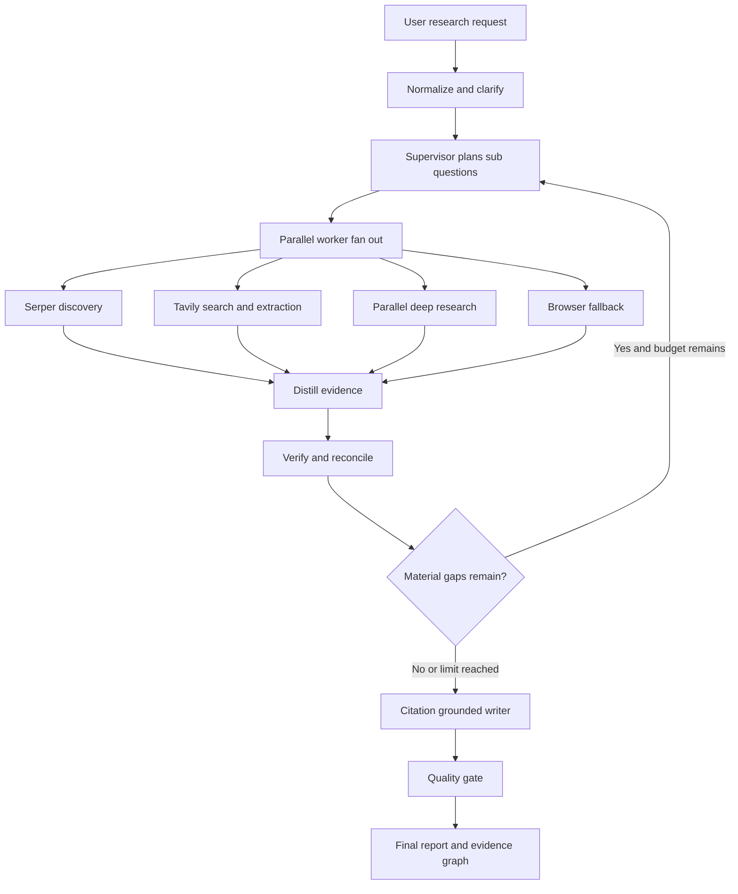
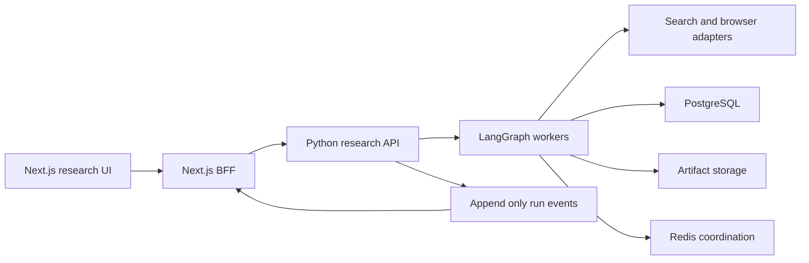

# Multi Agent Deep Research Assistant Technical Architecture Blueprint

**Status:** Implementation blueprint  
**Target duration:** 12 weeks  
**Primary stack:** Next.js 15, TypeScript, Python, LangGraph, PostgreSQL, Redis, Tailwind CSS  
**Optional bounded worker framework:** CrewAI  
**Research providers:** Serper, Tavily, Parallel, Playwright or Browserbase  
**Decision and validation layer:** Zod, Pydantic, model structured output, TypeSafe AI Jev

## 1. Executive decision

Build a production-style research command center in which a user submits a difficult question, watches a bounded team of research agents work in real time, inspects every source and claim, and receives a citation-grounded report with a transparent evidence trail.

The recommended topology is **LangGraph as the only lifecycle orchestrator**, using an **orchestrator-worker graph with bounded reflection**:

1. Clarify and normalize the request.
2. Generate a typed research plan.
3. Fan out independent research tasks.
4. Route each task to the cheapest suitable search provider.
5. Fetch and normalize source content.
6. Distill raw content into atomic evidence records.
7. Verify citations and reconcile contradictions.
8. Reflect on remaining coverage gaps.
9. Repeat research at most twice and only for material gaps.
10. Synthesize the final report from verified evidence, never from raw search output.

CrewAI should not run a second parent workflow inside LangGraph. Its agents may be used as bounded worker implementations where role-goal-backstory prompts improve specialization, but LangGraph must own graph state, retries, checkpointing, budgets, interruption, streaming, and termination. Running two autonomous orchestration systems as peers would duplicate state machines and make cancellation, tracing, replay, retries, and cost accounting harder to reason about.

TypeSafe AI Jev has a focused role. It is a fast typed-decision model for questions such as “is this source relevant?”, “which provider should handle this task?”, “is this claim sufficiently supported?”, and “should the reflection loop continue?”. It does **not** replace Zod or Pydantic validation. Zod validates transport shapes; Jev makes probabilistic typed judgments; deterministic code enforces budgets and safety.

## 2. System topology



### Execution sequence

1. `intake` validates the request, generates a run ID, sets budgets, and optionally asks one clarification question.
2. `planner` creates 3–8 non-overlapping sub-questions with success criteria and preferred source classes.
3. `dispatcher` emits one LangGraph `Send` operation per sub-question. Workers execute concurrently with a semaphore.
4. `provider_router` chooses Serper, Tavily, Parallel, or browser fallback based on task complexity, freshness, extraction needs, expected latency, and remaining budget.
5. `research_worker` discovers and fetches sources. Raw provider responses are stored outside graph state.
6. `distiller` converts source content into atomic claims, bounded summaries, direct evidence spans, caveats, and source metadata.
7. `verifier` confirms that evidence spans occur in the normalized source, evaluates source quality, detects duplicate claims, and records contradictions.
8. `reflector` measures coverage against the research plan. It can issue a small delta plan, terminate, or flag the answer as incomplete.
9. `writer` receives only verified evidence records and a report outline.
10. `quality_gate` rejects unsupported citations, missing sections, budget violations, or claims that lack evidence.
11. Events from every node are written to an append-only event log and streamed to the web client over SSE.

## 3. Why this pattern wins

### Pattern comparison

| Pattern | Strength | Weakness | Use in this system |
|---|---|---|---|
| Sequential pipeline | Predictable, cheap, easy to test | Poor latency and limited exploration | Intake, verification, synthesis, quality gate |
| Peer-to-peer agents | Flexible emergent collaboration | Unbounded conversation, difficult termination, context duplication | Do not use as the primary topology |
| Supervisor-worker | Central budgets, parallelism, explicit ownership | Supervisor can become a bottleneck | Primary topology |
| Hierarchical crews | Natural role delegation | Can hide routing and increase token cost | Optional bounded worker implementation |
| Orchestrator-worker with bounded reflection | Parallel breadth plus controlled iterative depth | Requires disciplined state and evaluation design | Recommended topology |

### Why bounded reflection matters

Deep research usually cannot know every information gap before the first search. A reflection step is therefore useful, but an unconstrained “research until satisfied” loop is unsafe. The reflector must operate under hard limits:

- `maxReflectionRounds = 2`
- `maxSubQuestions = 8` initially and 4 in a delta round
- `maxSearchCalls = 20` per run
- `maxBrowserSessions = 2`
- `maxSourcesPerSubQuestion = 6`
- `maxWallClockMs`
- `maxEstimatedCostUsd`
- no repeated normalized query within the same run
- terminate when marginal coverage gain is below a threshold

The LLM or Jev may recommend another round, but deterministic code makes the final decision.

## 4. Technology matrix

| Technology | Best capability | Production role | Advantages | Risks and controls |
|---|---|---|---|---|
| LangGraph | Stateful, long-running agent graphs | Parent orchestration, checkpoints, fan-out, interrupts, streaming | Explicit topology, durable execution, typed state, human-in-the-loop | State can grow without reducers; store raw artifacts externally |
| CrewAI | Role-focused agent teams and task semantics | Optional specialized worker adapter | Fast persona design, delegation and structured tasks | Do not let it own global retries or parent state |
| Serper | Fast real-time Google SERP and news discovery | Candidate URL discovery and freshness checks | Typically 1–2 second response, structured snippets, news/search endpoints | Snippets are not primary evidence; fetch the source before citing |
| Tavily | AI-oriented search, extraction, crawl, map and research | Dense content retrieval and domain-constrained search | Cleaned content, domain controls, answer and raw-content options | Generated answers can obscure provenance; keep result-level sources |
| Parallel | Long or multi-hop web research and structured enrichment | Escalation path for difficult tasks | Search, Task and MCP surfaces; asynchronous deep research; source basis | Higher latency/cost; use only after routing gate and poll status cheaply |
| Playwright | Deterministic browser automation | Local fallback for JS-heavy public pages | Browser contexts, locators, auto-waiting, network access | Expensive and brittle; sandbox, restrict domains, enforce timeouts |
| Browserbase | Managed remote browsers | Hosted browser fallback | Session management, proxies, authenticated states | Cost and sensitive sessions; isolate per tenant and encrypt secrets |
| TypeSafe AI Jev | Typed judgments with confidence | Routing, relevance, support and continuation gates | Choice, Score and Noul; multiple independent questions in one call | It is not a schema validator or long-form reasoner |
| Zod / Pydantic | Deterministic runtime schema validation | Every API, event, node input and output boundary | Clear errors and versioned contracts | Schema-valid data can still be factually wrong; follow with evidence checks |
| PostgreSQL | Durable relational state | Runs, plans, claims, sources, citations, budgets | Transactions, indexing, tenant isolation | Avoid storing enormous page bodies in hot tables |
| Redis | Ephemeral coordination | Rate limits, locks, semaphores, stream cursors, cache | Low latency | Never make Redis the only source of durable run state |

### Provider routing policy

| Task shape | First choice | Escalation |
|---|---|---|
| Discover authoritative URLs | Serper Search | Tavily Search |
| Breaking or recent news | Serper News | Tavily with date and domain filters |
| Extract relevant passages from known URLs | Tavily Extract | Browser fallback |
| Search plus cleaned, token-dense context | Tavily Search advanced | Parallel Search |
| Multi-hop question requiring synthesis across many sources | Parallel Task | Custom LangGraph worker set |
| Entity list enrichment | Parallel Task Group or FindAll | Serper plus extraction workers |
| JS-rendered or interactive page unavailable to extractors | Playwright or Browserbase | Mark unavailable |
| Logged-in page explicitly authorized by user | Isolated Browserbase session | Human upload/export |

Do not call all providers for every query. That creates correlated duplication, unnecessary cost, and more state to reconcile. Use a router, then escalate only on low coverage or low confidence.

## 5. Source ingestion and context distillation

### Principle

Raw pages and provider JSON must never be appended directly to the global prompt or central graph state. They are artifacts, not reasoning context.

### Distillation pipeline

1. **Canonicalize:** Normalize URL, strip tracking parameters, capture retrieval time and content hash.
2. **Classify source:** Official documentation, primary source, paper, news, secondary analysis, forum, or unknown.
3. **Normalize content:** Convert HTML/PDF output to clean text while preserving headings and location offsets.
4. **Deduplicate:** Compare canonical URL and content hash; merge mirrors and near-duplicates.
5. **Chunk locally:** Split by semantic section with token bounds. Do not place all chunks in `ResearchState`.
6. **Candidate extraction:** A worker emits atomic claims with an evidence span and source locator.
7. **Deterministic validation:** Confirm the cited span exists in normalized source text and that the URL belongs to the stored source.
8. **Semantic validation:** A verifier assesses whether the span supports, contradicts, or is unrelated to the claim.
9. **Cross-source merge:** Group semantically equivalent claims and preserve disagreements.
10. **Global projection:** Add only compact, verified `EvidenceClaim` records and IDs to graph state.

### Distilled insight contract

Each insight should contain one independently checkable proposition. It must not combine several facts under one citation. A valid insight includes:

- atomic claim
- source ID and canonical URL
- short supporting passage or offset range
- publication and retrieval timestamps when known
- support classification
- source-quality score
- confidence
- contradictions and caveats
- sub-question ID

The full page body belongs in object storage or an artifact table. The graph state should contain IDs and compact projections only.

## 6. TypeScript and Zod contracts

The browser, Next.js backend-for-frontend, event store, and Python service should share a versioned JSON contract. Generate Pydantic models from JSON Schema or maintain contract tests in CI.

```ts
import { z } from "zod";

export const RunStatusSchema = z.enum([
  "queued", "planning", "researching", "verifying",
  "reflecting", "writing", "completed", "failed", "cancelled"
]);

export const ProviderSchema = z.enum([
  "serper", "tavily", "parallel", "browser", "internal"
]);

export const BudgetSchema = z.object({
  maxWallClockMs: z.number().int().positive().max(30 * 60_000),
  maxSearchCalls: z.number().int().min(1).max(50),
  maxBrowserSessions: z.number().int().min(0).max(5),
  maxReflectionRounds: z.number().int().min(0).max(3),
  maxInputTokens: z.number().int().positive(),
  maxOutputTokens: z.number().int().positive(),
  maxEstimatedCostUsd: z.number().nonnegative(),
});

export const SourceSchema = z.object({
  id: z.string().uuid(),
  canonicalUrl: z.string().url(),
  title: z.string().min(1).max(500),
  publisher: z.string().max(250).nullable(),
  provider: ProviderSchema,
  sourceClass: z.enum([
    "official", "primary", "paper", "news", "secondary", "community", "unknown"
  ]),
  publishedAt: z.string().datetime().nullable(),
  retrievedAt: z.string().datetime(),
  contentHash: z.string().min(32),
  artifactRef: z.string().min(1),
  qualityScore: z.number().min(0).max(1),
});

export const CitationSchema = z.object({
  id: z.string().uuid(),
  sourceId: z.string().uuid(),
  quote: z.string().min(1).max(600),
  locator: z.object({
    heading: z.string().max(300).nullable(),
    startChar: z.number().int().nonnegative().nullable(),
    endChar: z.number().int().nonnegative().nullable(),
  }),
  verified: z.boolean(),
  verificationMethod: z.enum(["exact_span", "semantic_entailment", "manual"]),
});

export const EvidenceClaimSchema = z.object({
  id: z.string().uuid(),
  subQuestionId: z.string().uuid(),
  claim: z.string().min(1).max(1200),
  support: z.enum(["supported", "contradicted", "mixed", "insufficient"]),
  citationIds: z.array(z.string().uuid()).max(8),
  sourceIds: z.array(z.string().uuid()).min(1).max(8),
  confidence: z.number().min(0).max(1),
  caveats: z.array(z.string().max(500)).max(5),
  createdBy: z.string().min(1),
});

export const SubQuestionSchema = z.object({
  id: z.string().uuid(),
  question: z.string().min(5).max(1000),
  rationale: z.string().max(1000),
  successCriteria: z.array(z.string().max(400)).min(1).max(5),
  preferredProvider: ProviderSchema.optional(),
  sourceClasses: z.array(SourceSchema.shape.sourceClass).min(1),
  status: z.enum(["pending", "running", "complete", "failed", "skipped"]),
  attempts: z.number().int().nonnegative(),
});

export const ResearchGapSchema = z.object({
  id: z.string().uuid(),
  description: z.string().min(1).max(1000),
  severity: z.enum(["low", "medium", "high"]),
  suggestedQuery: z.string().max(500).nullable(),
  resolved: z.boolean(),
});

export const ResearchStateSchema = z.object({
  schemaVersion: z.literal("1.0"),
  runId: z.string().uuid(),
  tenantId: z.string().uuid(),
  userId: z.string().uuid(),
  threadId: z.string().min(1),
  status: RunStatusSchema,
  originalQuestion: z.string().min(5).max(10_000),
  normalizedQuestion: z.string().min(5).max(5_000),
  reportRequirements: z.array(z.string().max(500)).max(20),
  subQuestions: z.array(SubQuestionSchema).max(16),
  sourceIds: z.array(z.string().uuid()).max(200),
  evidenceClaimIds: z.array(z.string().uuid()).max(300),
  gaps: z.array(ResearchGapSchema).max(30),
  reflectionRound: z.number().int().nonnegative(),
  budget: BudgetSchema,
  usage: z.object({
    searchCalls: z.number().int().nonnegative(),
    browserSessions: z.number().int().nonnegative(),
    inputTokens: z.number().int().nonnegative(),
    outputTokens: z.number().int().nonnegative(),
    estimatedCostUsd: z.number().nonnegative(),
  }),
  finalReportArtifactRef: z.string().nullable(),
  errorCode: z.string().nullable(),
  createdAt: z.string().datetime(),
  updatedAt: z.string().datetime(),
});
```

### Node transition and SSE event contracts

```ts
export const AgentEventSchema = z.discriminatedUnion("type", [
  z.object({
    type: z.literal("node.started"),
    eventId: z.string(), runId: z.string().uuid(), timestamp: z.string().datetime(),
    nodeId: z.string(), agent: z.string(), label: z.string(),
  }),
  z.object({
    type: z.literal("node.progress"),
    eventId: z.string(), runId: z.string().uuid(), timestamp: z.string().datetime(),
    nodeId: z.string(), message: z.string(), percent: z.number().min(0).max(100).nullable(),
  }),
  z.object({
    type: z.literal("source.discovered"),
    eventId: z.string(), runId: z.string().uuid(), timestamp: z.string().datetime(),
    source: SourceSchema.pick({ id: true, canonicalUrl: true, title: true, sourceClass: true }),
  }),
  z.object({
    type: z.literal("claim.verified"),
    eventId: z.string(), runId: z.string().uuid(), timestamp: z.string().datetime(),
    claim: EvidenceClaimSchema,
  }),
  z.object({
    type: z.literal("report.delta"),
    eventId: z.string(), runId: z.string().uuid(), timestamp: z.string().datetime(),
    markdownDelta: z.string(),
  }),
  z.object({
    type: z.literal("run.completed"),
    eventId: z.string(), runId: z.string().uuid(), timestamp: z.string().datetime(),
    reportUrl: z.string().url(),
  }),
  z.object({
    type: z.literal("run.failed"),
    eventId: z.string(), runId: z.string().uuid(), timestamp: z.string().datetime(),
    code: z.string(), message: z.string(), retryable: z.boolean(),
  }),
]);
```

Reducers must deduplicate arrays by stable IDs. Do not concatenate blindly when parallel nodes merge.

## 7. Agent and node specification

### Supervisor and planner

Responsibilities:

- determine whether clarification is required
- decompose the question into orthogonal sub-questions
- specify required source classes and freshness
- set provider hints without forcing a provider
- prevent duplicate or overly broad tasks

Output must be structured and schema validated. If structured output parsing fails, retry once with the validation error, then fail safely.

### Provider router

The router uses deterministic rules first. Jev can handle ambiguous judgments in one batched call:

- Choice: `serper | tavily | parallel | browser`
- Score: expected research complexity
- Noul: whether fresh news is required
- Noul: whether multi-hop synthesis is required
- Noul: whether known URLs must be rendered in a browser

Code then applies budget and permission constraints. Low-confidence routing falls back to Tavily or a deterministic rule, not another LLM loop.

### Research workers

Workers receive only their sub-question, limited run context, provider adapter, and remaining local budget. They do not receive the full accumulated conversation.

A CrewAI worker may define a role, goal, backstory, tools and structured task output. Its entire execution is still one LangGraph node from the parent graph's perspective. It returns a typed `WorkerResult`; it cannot directly mutate global state.

Recommended initial worker roles:

- official-source researcher
- recent-news researcher
- technical-documentation researcher
- academic evidence researcher
- contrarian or counter-evidence researcher

Create roles dynamically only when required by the plan. Do not instantiate all agents for every run.

### Distiller

The distiller receives one source chunk at a time or a small related batch. It emits atomic claims and evidence spans. It cannot write prose for the final answer.

### Verifier

The verifier performs:

1. exact-span check
2. domain and source identity check
3. semantic support classification
4. date and freshness check
5. contradiction detection
6. source-quality assessment

Unsupported claims remain stored for audit but are excluded from writer context.

### Reflector

The reflector sees the plan, compact claim ledger, contradiction ledger, gaps and budget—not raw pages. It returns:

```ts
const ReflectionDecisionSchema = z.object({
  decision: z.enum(["continue", "synthesize", "incomplete"]),
  coverageScore: z.number().min(0).max(1),
  materialGaps: z.array(ResearchGapSchema).max(4),
  expectedMarginalGain: z.number().min(0).max(1),
});
```

Continue only when gaps are material, expected gain exceeds a configured threshold, and all budgets allow it.

### Writer and quality gate

The writer receives an outline plus verified claims and citation metadata. Every factual paragraph should reference claim IDs. A deterministic post-processor converts claim IDs to citation markers and rejects unknown IDs.

The quality gate checks:

- every citation resolves to a stored source
- every cited claim is verified
- the report does not cite a search-result snippet as if it were a primary source
- conflicting evidence is acknowledged
- required sections exist
- no provider or model claims unsupported confidence
- markdown is safe for rendering

## 8. LangGraph routing sketch

```python
from langgraph.graph import StateGraph, START, END
from langgraph.types import Send

def dispatch_workers(state):
    pending = [q for q in state["sub_questions"] if q["status"] == "pending"]
    return [Send("research_worker", {
        "run_id": state["run_id"],
        "sub_question": q,
        "remaining_budget": remaining_budget(state),
    }) for q in pending[: state["concurrency_limit"]]]

def route_after_reflection(state):
    decision = state["reflection_decision"]
    hard_stop = (
        state["reflection_round"] >= state["budget"]["max_reflection_rounds"]
        or budget_exhausted(state)
    )
    if hard_stop or decision["decision"] in {"synthesize", "incomplete"}:
        return "writer"
    return "planner_delta"

graph = StateGraph(ResearchState)
graph.add_node("intake", intake)
graph.add_node("planner", planner)
graph.add_node("research_worker", research_worker)
graph.add_node("distill_and_verify", distill_and_verify)
graph.add_node("reflector", reflector)
graph.add_node("planner_delta", planner_delta)
graph.add_node("writer", writer)
graph.add_node("quality_gate", quality_gate)

graph.add_edge(START, "intake")
graph.add_edge("intake", "planner")
graph.add_conditional_edges("planner", dispatch_workers, ["research_worker"])
graph.add_edge("research_worker", "distill_and_verify")
graph.add_edge("distill_and_verify", "reflector")
graph.add_conditional_edges("reflector", route_after_reflection,
                            {"planner_delta": "planner_delta", "writer": "writer"})
graph.add_conditional_edges("planner_delta", dispatch_workers, ["research_worker"])
graph.add_edge("writer", "quality_gate")
graph.add_edge("quality_gate", END)
```

In a real implementation, use reducers for fan-in, a persistent checkpointer, concurrency semaphores, idempotent node writes, and an outbox for events.

## 9. API and persistence architecture

### Service boundaries



### Application endpoints

- `POST /api/research/runs` — validate input, create a run, return `202` and `runId`
- `GET /api/research/runs/:runId` — current durable run projection
- `GET /api/research/runs/:runId/events` — SSE stream with replay from `Last-Event-ID`
- `POST /api/research/runs/:runId/cancel` — idempotent cancellation request
- `POST /api/research/runs/:runId/resume` — resume after interrupt or approval
- `GET /api/research/runs/:runId/report` — final report and evidence map
- `GET /api/research/sources/:sourceId` — safe source metadata and permitted excerpt

### Provider endpoints verified from current documentation

- Tavily Search: `POST https://api.tavily.com/search`
- Tavily Research: `POST https://api.tavily.com/research`
- Serper Search: `POST https://google.serper.dev/search`
- Serper News: `POST https://google.serper.dev/news`
- TypeSafe AI System One: `POST https://api.typesafe.ai/v1/systemone`
- Parallel Task MCP: `https://task-mcp.parallel.ai/mcp` using Streamable HTTP

For Parallel REST Search and Task APIs, use the current official SDK generated from its API specification rather than hard-coding beta paths. Pin the SDK version and contract-test provider adapters.

### Persistence

Use PostgreSQL for:

- tenants and users
- research runs and versioned plans
- sub-questions and attempts
- source metadata
- evidence claims and citations
- contradictions and gaps
- usage ledger and budgets
- node executions
- append-only run events
- report versions and evaluations

Use LangGraph checkpointers for thread-scoped execution snapshots. Use a store or normal application tables for long-term user preferences and reusable research memory. Keep these concepts separate.

Raw HTML, extracted page bodies, PDFs and large provider payloads go to object storage with content hashes and retention policies.

## 10. SSE and Next.js integration

### Recommended transport

1. Client sends `POST /api/research/runs`.
2. Server immediately returns `{ runId, status: "queued" }`.
3. Client opens `GET /api/research/runs/{runId}/events` using `EventSource`.
4. BFF authenticates with an HTTP-only session cookie and proxies or subscribes to backend events.
5. The SSE endpoint sets `Content-Type: text/event-stream`, sends heartbeat comments, includes stable event IDs, and supports `Last-Event-ID` replay.
6. On reconnect, the client first reconciles the durable run projection, then applies later events.

Do not depend on an unbounded in-memory connection map. Events must be persisted before publication using a transactional outbox or equivalent pattern.

Native `EventSource` performs GET requests and does not allow arbitrary authorization headers. Prefer same-origin cookie authentication. If bearer headers are mandatory, use a `fetch()` streaming client instead.

```ts
// app/api/research/runs/[runId]/events/route.ts
export const runtime = "nodejs";
export const dynamic = "force-dynamic";

export async function GET(
  request: Request,
  { params }: { params: Promise<{ runId: string }> }
) {
  const { runId } = await params;
  const session = await requireSession(request);
  await assertRunAccess(session.user.id, runId);

  const lastEventId = request.headers.get("last-event-id");
  const upstream = await openBackendEventStream({ runId, lastEventId, session });

  return new Response(upstream, {
    headers: {
      "Content-Type": "text/event-stream",
      "Cache-Control": "no-cache, no-transform",
      "Connection": "keep-alive",
      "X-Accel-Buffering": "no",
    },
  });
}
```

Deployment platforms may impose duration limits or buffer responses. Test the exact production adapter. For long research runs, host the SSE service on infrastructure that supports long-lived connections or use a managed realtime channel while retaining the same event contract.

## 11. UI and UX specification

### Product concept

The interface should feel like a professional research operations console, not a chatbot. The user should simultaneously understand:

- what the system is doing
- which agents are active
- what evidence has been found
- what remains uncertain
- how much time and budget have been used
- how each final claim maps to sources

### Desktop layout

Use a three-region shell:

1. **Left rail, 260–300 px:** project navigation, saved runs, filters, agent status and run history.
2. **Center workspace, flexible:** research brief, streaming report, outline and claim-level citation markers.
3. **Right intelligence rail, 340–400 px:** execution tree, live events, sources, gaps, contradictions and budgets.

The right rail can switch among `Agents`, `Evidence`, `Sources`, and `Logs`. Users should not be forced to watch raw logs to understand progress.

### Component hierarchy

```text
ResearchWorkspace
├── WorkspaceHeader
│   ├── RunStatus
│   ├── BudgetMeter
│   └── CancelResumeActions
├── ResearchInputPanel
│   ├── QuestionComposer
│   ├── DepthSelector
│   └── SourceAndDomainControls
├── SplitPane
│   ├── ReportCanvas
│   │   ├── ResearchPlan
│   │   ├── StreamingMarkdown
│   │   ├── InlineCitation
│   │   └── EvidencePopover
│   └── IntelligenceRail
│       ├── AgentExecutionTree
│       ├── EvidenceLedger
│       ├── SourceExplorer
│       ├── GapAndConflictPanel
│       └── LiveEventConsole
└── BottomTimeline
    ├── NodeSpans
    ├── ProviderCalls
    └── RetryAndCheckpointMarkers
```

### Visual language

- Background: near-black graphite, not pure black.
- Surfaces: restrained elevated panels with clear borders rather than excessive glass blur.
- Status colors: blue planning, violet research, amber verification, cyan writing, green complete, red failure.
- Typography: readable sans-serif for report content; monospaced type only for IDs, events and metrics.
- Motion: subtle state transitions and node pulses; disable decorative looping animation during long runs.
- Density: high but hierarchical. Provide `Focus report` and `Inspect execution` modes.

### Agent execution tree

Show a vertical tree with expandable nodes:

- node name and worker role
- running, queued, complete, retrying or failed state
- provider icon
- elapsed time
- sources found
- verified claims
- token and cost estimate

Do not expose private chain-of-thought. Show concise, generated progress summaries and tool metadata instead.

### Citation interaction

Clicking citation `[12]` opens a side popover containing:

- source title, publisher, URL and date
- exact supporting passage
- verification status
- source-quality indicator
- claims supported by the source
- `Open source` action

If sources disagree, show both passages in a comparison view rather than hiding the conflict.

### Responsive behavior

- **Large monitor:** full three-region shell.
- **Laptop:** collapsible left rail; right rail 320 px; report remains dominant.
- **Tablet:** center workspace plus right rail drawer.
- **Mobile:** report-first single column; agents and sources in bottom sheets; timeline becomes a compact progress stepper.

## 12. Reliability, scaling and security

### Concurrency

Use a per-run semaphore and a global provider semaphore. Parallel workers should be independently retryable. `Promise.all` is acceptable only when every task has independent failure capture; use `Promise.allSettled` when partial results are allowed. In the Python LangGraph runtime, prefer graph-native fan-out and reducers rather than hiding concurrency in one opaque node.

### Idempotency

- client supplies or server issues an idempotency key when creating a run
- provider calls have request fingerprints
- node output writes use `(run_id, node_id, attempt, output_hash)` uniqueness
- events use monotonic run-local sequence numbers
- cancellation is idempotent
- report publication uses a versioned compare-and-swap

### Multi-tenancy

- tenant ID on every durable record
- database row-level access policy or repository-level mandatory scoping
- per-tenant encrypted provider keys
- per-tenant rate and cost budgets
- separate browser contexts for every run
- audit logs for source access, approvals and exports

### Prompt injection and browser security

Treat every webpage as untrusted data. Page text cannot change system instructions, budgets, permissions, target domains or tool access.

- separate instructions from retrieved content
- strip active content and scripts from normalized text
- allowlist browser protocols and block local/private IP ranges
- block file downloads by default
- disable arbitrary code execution
- never expose secrets to page content
- classify page instructions as quoted evidence, not commands
- require approval for authenticated or side-effecting browser actions

## 13. Failure modes and mitigations

| Failure | Detection | Mitigation |
|---|---|---|
| Infinite reflection | Round and budget counters | Hard cap plus marginal-gain threshold |
| Context bloat | State-size and token telemetry | External raw artifacts, compact claim ledger, per-worker local state |
| Duplicate queries | Normalized query fingerprint | Reject or merge duplicate work |
| Exponential agent delegation | Child-count and depth limits | Parent-only dispatch; workers cannot spawn without policy |
| Citation hallucination | Citation ID lookup and exact-span check | Reject unknown or unsupported citations |
| Search snippet treated as evidence | Source-type validation | Fetch original page before claim verification |
| Conflicting sources hidden | Contradiction clustering | Present disagreement and source quality |
| Schema-valid nonsense | Semantic/evidence verification | Zod/Pydantic plus verifier and evals |
| Parallel merge overwrites state | Reducer tests | Merge by stable ID with deterministic conflict policy |
| Provider timeout | Deadline telemetry | Circuit breaker, bounded retry and alternate provider |
| Retry duplicates cost | Request fingerprints | Idempotent provider-call ledger |
| SSE disconnect loses progress | Event sequence gap | Persistent event log and `Last-Event-ID` replay |
| Worker crash loses run | Missing heartbeat/checkpoint | Persistent checkpointer and lease expiry |
| Browser prompt injection | Security classifier and policy logs | Treat web text as data; restricted browser sandbox |
| Stale facts | Publication/retrieval timestamps | Freshness requirements and recency routing |
| CrewAI and LangGraph state drift | Contract tests | Crew adapter returns one typed result; no shared mutable state |

## 14. Evaluation plan

Create a benchmark of at least 60 questions across:

- technical documentation comparison
- current-event research
- product and company research
- academic literature synthesis
- conflicting evidence
- questions intentionally lacking sufficient evidence

Measure:

- claim precision
- citation correctness
- citation completeness
- source authority and diversity
- contradiction recall
- answer completeness
- unsupported-claim rate
- mean and P95 latency
- tokens and cost per completed report
- provider routing accuracy
- recovery after injected worker/provider failures
- SSE replay correctness

Run ablations:

- supervisor-worker vs sequential
- reflection disabled vs one vs two rounds
- Serper-only vs Tavily-only vs routed providers
- Jev routing vs deterministic routing
- CrewAI worker vs plain LangGraph worker
- raw-source context vs distilled-claim context

This turns framework choices into measured engineering decisions rather than résumé keywords.

## 15. Twelve-week implementation plan

### Weeks 1–2: Contracts and vertical slice

- monorepo and local Docker environment
- run, state and event schemas
- Next.js shell and research composer
- LangGraph intake, planner, one worker, writer
- Serper and Tavily adapters
- end-to-end SSE stream

### Weeks 3–4: Evidence architecture

- source normalization and artifact storage
- distiller and verifier
- citation ledger and citation popovers
- deduplication and contradiction records
- report quality gate

### Weeks 5–6: Multi-agent execution

- graph-native fan-out/fan-in
- provider router
- optional CrewAI worker adapter
- bounded reflector and delta planning
- cancellation, retries and checkpoints

### Weeks 7–8: Advanced web research

- Parallel Task integration
- Playwright or Browserbase fallback
- domain and freshness controls
- prompt-injection defenses
- research gap and contradiction UI

### Weeks 9–10: Production systems

- tenant isolation and usage ledger
- Redis coordination and rate limits
- PostgreSQL checkpointer or durable run storage
- event outbox and reconnect replay
- provider circuit breakers and idempotency

### Weeks 11–12: Evaluation and public launch

- 60-question benchmark
- model and provider comparisons
- k6 load tests
- failure injection
- architecture and threat-model documentation
- public hosted demo, demo video and engineering report

## 16. Minimum viable version and intentional exclusions

The first credible release should include:

- LangGraph supervisor-worker topology
- Serper and Tavily routing
- 3–5 concurrent research workers
- source distillation and citation verification
- one bounded reflection round
- PostgreSQL persistence
- live SSE execution UI
- exported markdown report
- evaluation dashboard with at least 20 benchmark questions

Delay these until the core is measured:

- fully autonomous browser navigation
- CrewAI hierarchical manager mode
- user-created arbitrary agents
- vector memory for everything
- Kubernetes
- multiple model providers per node
- automatic side-effecting actions

## 17. Documentation map and primary sources

### LangGraph

- [Overview](https://docs.langchain.com/oss/python/langgraph/overview)
- [Workflows and agents](https://docs.langchain.com/oss/python/langgraph/workflows-agents)
- [Graph API](https://docs.langchain.com/oss/python/langgraph/graph-api)
- [Subgraphs](https://docs.langchain.com/oss/python/langgraph/use-subgraphs)
- [Persistence](https://docs.langchain.com/oss/python/langgraph/persistence)
- [Durable execution](https://docs.langchain.com/oss/python/langgraph/durable-execution)
- [Streaming](https://docs.langchain.com/oss/python/langgraph/streaming)
- [Event streaming](https://docs.langchain.com/oss/python/langgraph/event-streaming)

### CrewAI

- [CrewAI documentation](https://docs.crewai.com/)
- [Official repository](https://github.com/crewAIInc/crewAI)
- [Documentation index](https://docs.crewai.com/llms.txt)

### Tavily

- [Tavily documentation](https://docs.tavily.com/welcome)
- [Search endpoint](https://docs.tavily.com/documentation/api-reference/endpoint/search)
- [Research endpoint](https://docs.tavily.com/documentation/api-reference/endpoint/research)
- [Search best practices](https://docs.tavily.com/documentation/best-practices/best-practices-search)
- [LangChain integration](https://docs.tavily.com/documentation/integrations/langchain)

### Parallel

- [Parallel documentation](https://docs.parallel.ai/introduction)
- [Task API product](https://parallel.ai/products/task)
- [Task MCP](https://docs.parallel.ai/integrations/mcp/task-mcp)
- [Parallel documentation index](https://docs.parallel.ai/llms.txt)

### Serper

- [Serper API](https://serper.dev/)

### TypeSafe AI Jev

- [Introduction](https://docs.typesafe.ai/introduction)
- [API reference](https://docs.typesafe.ai/api)
- [Primitives](https://docs.typesafe.ai/primitives)
- [Patterns](https://docs.typesafe.ai/patterns)
- [Confidence](https://docs.typesafe.ai/confidence)

### Frontend and browser infrastructure

- [Next.js streaming](https://nextjs.org/docs/app/guides/streaming)
- [Next.js Route Handlers](https://nextjs.org/docs/app/api-reference/file-conventions/route)
- [MDN server-sent events](https://developer.mozilla.org/en-US/docs/Web/API/Server-sent_events/Using_server-sent_events)
- [Playwright browser contexts](https://playwright.dev/docs/browser-contexts)
- [Playwright auto-waiting](https://playwright.dev/docs/actionability)
- [Browserbase web data retrieval](https://docs.browserbase.com/use-cases/web-data-retrieval)

## Final architectural rule

The system must be **bounded, evidence-first and replayable**. LangGraph owns execution. Provider adapters retrieve information. Distillers turn untrusted content into small evidence units. Verifiers decide what may enter the report. Jev assists typed judgment. Zod and Pydantic enforce contracts. The writer never receives uncontrolled raw web context, and the frontend renders durable events rather than pretending that token streaming alone is observability.
