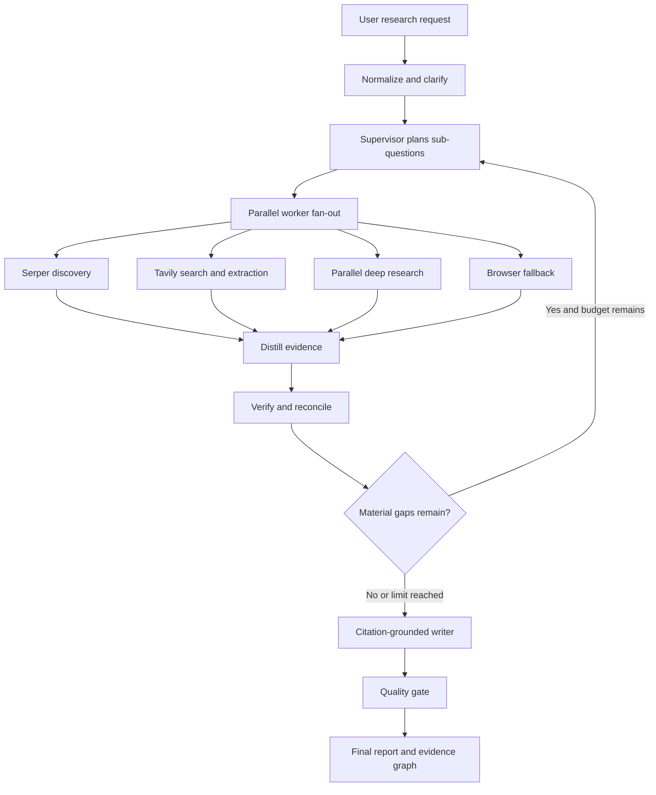
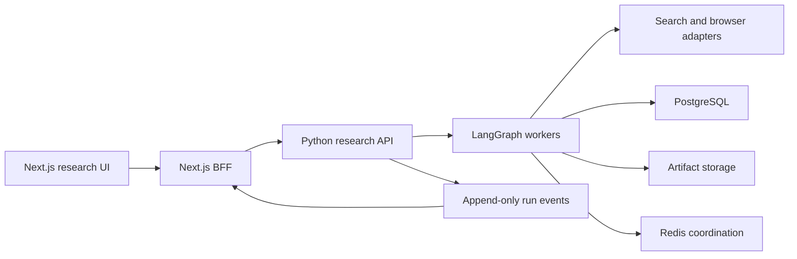
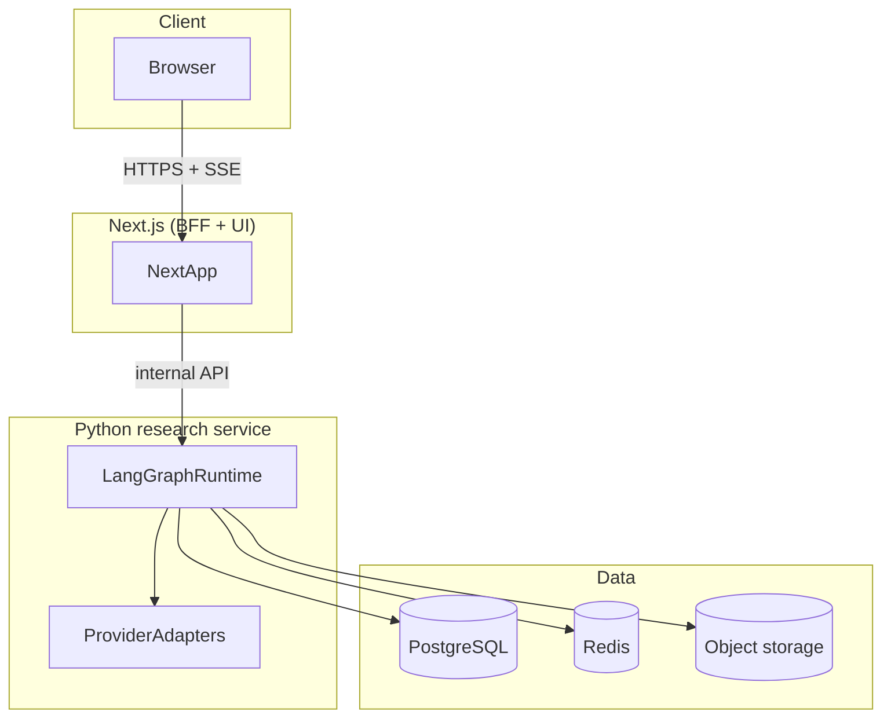
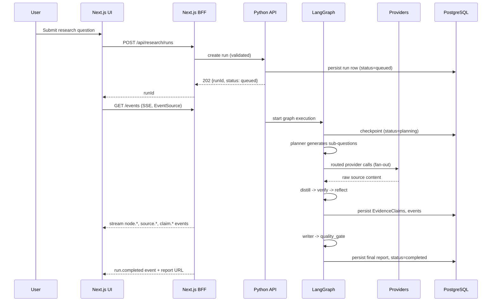

# Architecture

See also: [research-workflow.md](./research-workflow.md) for a step-by-step
walkthrough of one run, [langgraph.md](./langgraph.md) for the orchestration
implementation, and [state-management.md](./state-management.md) for the
data contracts referenced here.

## Executive architecture

The system builds a production-style research command center. A user
submits a difficult question, watches a bounded team of research agents
work in real time, inspects every source and claim, and receives a
citation-grounded report with a transparent evidence trail.

The topology is **LangGraph as the only lifecycle orchestrator**, running
an **orchestrator-worker graph with bounded reflection**:

1. Clarify and normalize the request.
2. Generate a typed research plan.
3. Fan out independent research tasks.
4. Route each task to the cheapest suitable search provider.
5. Fetch and normalize source content.
6. Distill raw content into atomic evidence records.
7. Verify citations and reconcile contradictions.
8. Reflect on remaining coverage gaps.
9. Repeat research at most twice, and only for material gaps.
10. Synthesize the final report from verified evidence, never from raw
    search output.

**CrewAI** may supply bounded worker implementations (role/goal/backstory
agents) where specialization helps, but it never runs as a second parent
workflow. LangGraph owns graph state, retries, checkpointing, budgets,
interruption, streaming, and termination — running two autonomous
orchestration systems as peers would duplicate state machines and make
cancellation, tracing, replay, retries, and cost accounting harder to
reason about.

**TypeSafe AI Jev** is a fast, typed-decision model for narrow probabilistic
questions ("is this source relevant?", "which provider should handle this
task?", "is this claim sufficiently supported?", "should reflection
continue?"). It does not replace Zod/Pydantic schema validation, and it
does not enforce budgets or safety — deterministic code does.

## Why this pattern wins

| Pattern | Strength | Weakness | Use in this system |
|---|---|---|---|
| Sequential pipeline | Predictable, cheap, easy to test | Poor latency, limited exploration | Intake, verification, synthesis, quality gate |
| Peer-to-peer agents | Flexible emergent collaboration | Unbounded conversation, hard termination, context duplication | Not used as primary topology |
| Supervisor-worker | Central budgets, parallelism, explicit ownership | Supervisor can become a bottleneck | Primary topology |
| Hierarchical crews | Natural role delegation | Can hide routing, increase token cost | Optional bounded worker implementation (CrewAI) |
| Orchestrator-worker + bounded reflection | Parallel breadth + controlled iterative depth | Requires disciplined state/eval design | **Recommended topology** |

Deep research usually cannot know every information gap before the first
search, so *some* reflection is useful — but an unconstrained
"research until satisfied" loop is unsafe. See
[reflection.md](./reflection.md) for the hard limits that make reflection
safe.

## System topology

## Major components

| Component | Role |
|---|---|
| Next.js 15 app (BFF + UI) | Research composer, streaming report, execution console, SSE client |
| Python research service | Hosts the LangGraph graph and node implementations |
| LangGraph runtime | Owns graph state, checkpoints, fan-out/fan-in, interrupts, streaming |
| Provider adapters | Serper, Tavily, Parallel, Playwright/Browserbase — see [provider-routing.md](./provider-routing.md) |
| Distiller/Verifier | Converts raw content into verified `EvidenceClaim` records — see [evidence-system.md](./evidence-system.md) |
| TypeSafe AI Jev | Typed judgments for routing, relevance, support, continuation |
| PostgreSQL | Durable relational state — see [database.md](./database.md) |
| Redis | Ephemeral coordination — see [redis.md](./redis.md) |
| Object storage | Raw HTML/PDF/provider payloads — see [artifact-storage.md](./artifact-storage.md) |
| Event log + SSE | Append-only, replayable execution events — see [events-and-sse.md](./events-and-sse.md) |

## Service boundaries

## Data flow (logical)

1. The frontend BFF authenticates the request and calls the Python research
   API to create a run.
2. The Python API validates input against the `ResearchState`/request
   schema, creates a durable run row, and hands off to LangGraph.
3. LangGraph executes the graph (see [langgraph.md](./langgraph.md)),
   calling provider adapters and writing durable projections to PostgreSQL,
   large payloads to object storage, and events to the append-only event
   log.
4. The Next.js BFF subscribes to `/api/research/runs/:runId/events` (SSE)
   and streams updates to the browser.
5. On completion, the final report and evidence graph are available via
   `/api/research/runs/:runId/report`.

## Execution sequence

| Step | Node | Summary |
|---|---|---|
| 1 | `intake` | Validates the request, generates a run ID, sets budgets, optionally asks one clarification question |
| 2 | `planner` | Creates 3–8 non-overlapping sub-questions with success criteria and preferred source classes |
| 3 | `dispatcher` | Emits one `Send` per sub-question; workers run concurrently under a semaphore |
| 4 | `provider_router` | Chooses Serper, Tavily, Parallel, or browser fallback per task |
| 5 | `research_worker` | Discovers and fetches sources; raw responses stored outside graph state |
| 6 | `distiller` | Converts source content into atomic claims, spans, caveats, source metadata |
| 7 | `verifier` | Confirms spans occur in the normalized source, scores source quality, detects duplicates/contradictions |
| 8 | `reflector` | Measures coverage vs. the plan; issues a delta plan, terminates, or flags the answer incomplete |
| 9 | `writer` | Receives only verified evidence records and a report outline |
| 10 | `quality_gate` | Rejects unsupported citations, missing sections, budget violations, evidence-less claims |

Every node emits events to the append-only event log, streamed to the web
client over SSE. Full detail: [research-workflow.md](./research-workflow.md).

## Agent lifecycle

See [agents.md](./agents.md) for a per-node input/output/responsibility
table, and [reflection.md](./reflection.md) for how the loop back to
`planner_delta` is bounded and terminated.

## Provider layer

See [provider-routing.md](./provider-routing.md) for the full routing
policy. In summary: a deterministic router chooses the cheapest suitable
provider per task shape; Jev resolves ambiguous cases in a single batched
call; code applies budget/permission constraints last. The system never
calls every provider for every query.

## Evidence layer

See [evidence-system.md](./evidence-system.md) and
[citation-verification.md](./citation-verification.md). Raw pages and
provider JSON are never appended directly to the global prompt or central
graph state — they are artifacts, not reasoning context. Only compact,
verified `EvidenceClaim` projections and IDs enter `ResearchState`.

## Persistence layer

See [database.md](./database.md), [redis.md](./redis.md), and
[artifact-storage.md](./artifact-storage.md). PostgreSQL holds durable
relational state; Redis holds ephemeral coordination primitives; object
storage holds large raw payloads referenced by content hash.

## Event layer

See [events-and-sse.md](./events-and-sse.md). Events are persisted via a
transactional outbox before publication, carry stable IDs, and support
`Last-Event-ID` replay on reconnect.

## Frontend/backend relationship

The Next.js app is both the UI and a backend-for-frontend (BFF): it
authenticates the browser session, proxies/subscribes to backend run
events, and never talks to providers, the database, or object storage
directly. See [frontend.md](./frontend.md) and [api.md](./api.md).

## Deployment architecture

See [deployment.md](./deployment.md) for environment-by-environment detail
(`PROPOSED` — no target infrastructure has been confirmed against a real
repository yet).

## Security boundaries

- Every webpage fetched by a worker is untrusted data; it cannot change
  system instructions, budgets, permissions, target domains, or tool
  access. See [prompt-injection.md](./prompt-injection.md).
- Every durable record carries a tenant ID; access is scoped at the
  database/repository layer. See [security.md](./security.md).
- Browser automation runs in isolated, per-run contexts with a protocol/IP
  allowlist and no arbitrary code execution.
- Secrets (provider API keys, session tokens) are never exposed to page
  content or to the LLM's tool-call surface for browsing.

## Runtime architecture: what actually happens during one research run

This is the concrete trace corresponding to the logical architecture above.
See [research-workflow.md](./research-workflow.md) for the full transition
table (including failure/retry/cancel/resume paths).

