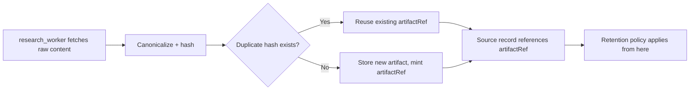

# Artifact Storage

Where large, raw content lives, as opposed to the compact projections in
PostgreSQL. See [state-management.md](./state-management.md#source) for
the `artifactRef` field this document explains, and
[evidence-system.md](./evidence-system.md) for why raw content is
externalized in the first place.

## What lives here

- Raw HTML of fetched pages
- Extracted page bodies (post-normalization, pre-chunking)
- PDFs and other binary source documents
- Full raw provider JSON payloads (Serper/Tavily/Parallel responses)
- Large research artifacts not suited to a relational row (e.g., a full
  browser session trace, if retained)

## Content hashes

Every stored artifact is content-addressed: a hash of the normalized
content is computed at canonicalization time (see
[evidence-system.md](./evidence-system.md#distillation-pipeline)) and used
for:
- Deduplication — identical or near-identical content across sources
  (mirrors, syndication) is not stored twice.
- Integrity — a `Citation`'s exact-span check can be re-verified later
  against the exact bytes that were originally checked.

## Artifact references

`Source.artifactRef` is the only pointer `ResearchState`/PostgreSQL holds into object storage. The
implemented key is `tenants/{tenantId}/runs/{runId}/sha256/{contentHash}` and remains opaque to
consumers. `S3ArtifactStore` is the production-facing interface; local development uses
S3-compatible LocalStack and the `research-artifacts` bucket. Full bodies never enter hot tables.

## Retention

- Artifacts are retained for at least the life of the run they support,
  to allow citation re-verification and audit.
- A tenant-configurable retention policy governs deletion after that
  (`PROPOSED` — exact default window pending repository/product
  decision).
- Deletion must not silently orphan a `Source.artifactRef` still
  referenced by a completed report — either the report references remain
  resolvable for its own retention period, or deletion is deferred until
  no active report references the artifact.

## Lifecycle

## Access control

- Artifacts are **never** served directly to the frontend. The
  `GET /api/research/sources/:sourceId` endpoint (see [api.md](./api.md))
  returns metadata plus the *specific verified excerpt* tied to a
  citation — not the full raw artifact.
- Access to raw artifacts (e.g., for internal debugging or evaluation
  tooling) is tenant-scoped and audited the same way any other sensitive
  read is — see [security.md](./security.md#audit-logs).
- Object storage credentials are never exposed to the browser or to
  browsed page content (see [prompt-injection.md](./prompt-injection.md)).
