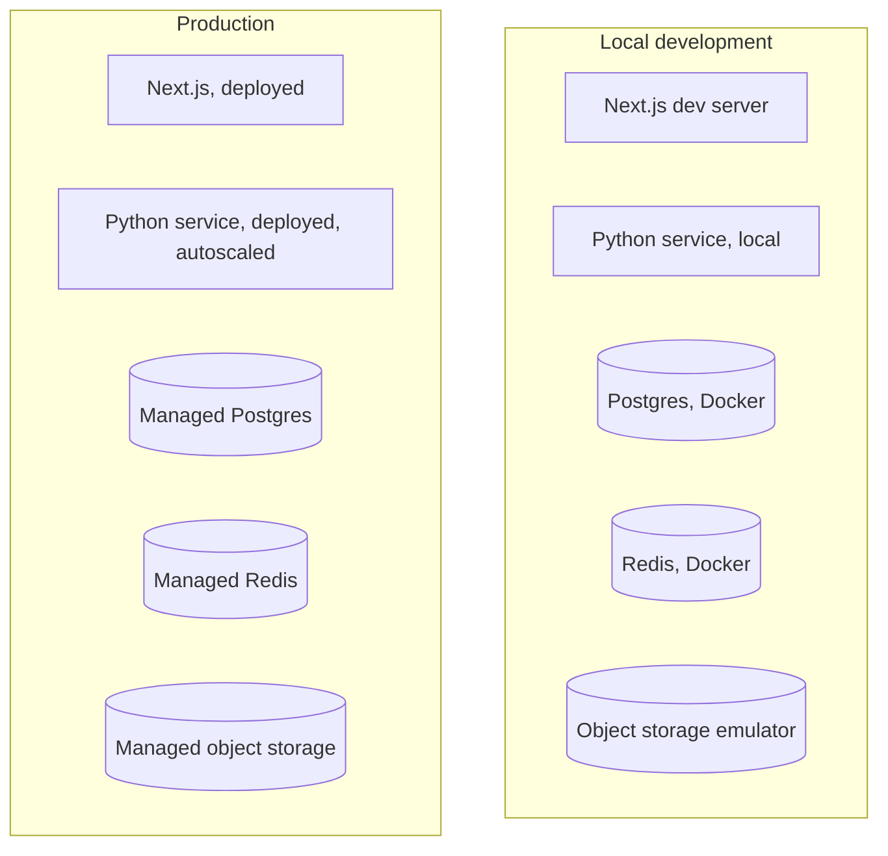

# Deployment

Production rollout of the system's services. `PROPOSED` throughout — no
target infrastructure has been confirmed against a real repository; this
describes a reasonable deployment shape consistent with the architecture
blueprint's service boundaries (see [architecture.md](./architecture.md#deployment-architecture)).

## Services to deploy

| Service | Runtime | Notes |
|---|---|---|
| Next.js app (UI + BFF) | Node.js, edge or serverless per route needs | The SSE route (`/events`) needs long-lived-connection support — see [events-and-sse.md](./events-and-sse.md#transport) |
| Python research service (LangGraph runtime) | Python, long-running process(es) | Hosts the graph; needs to survive multi-minute runs |
| PostgreSQL | Managed relational DB | Durable state + LangGraph checkpointer — see [database.md](./database.md) |
| Redis | Managed cache/coordination | Ephemeral only — see [redis.md](./redis.md) |
| Object storage | S3-compatible or equivalent | Raw artifacts — see [artifact-storage.md](./artifact-storage.md) |
| Provider APIs | External (Serper, Tavily, Parallel, Jev, Browserbase) | Credentials per [security.md](./security.md#provider-credentials) |

## Local development vs. production

See [development.md](./development.md) for the local setup.

## Environment configuration

Every configurable value is catalogued in
[configuration.md](./configuration.md), organized by domain
(Application, Database, Redis, LangGraph, Models, Providers, Budgets,
Concurrency, Browser, SSE, Security, Storage, Observability, Evaluation).
Do not duplicate configuration values in this file — link to it.

## Secrets

Provider API keys, database credentials, and service-to-service auth
material are injected via the deployment platform's secret management, not
committed to the repository — see [security.md](./security.md#secret-management).

## Health checks

`PROPOSED`:
- Next.js: standard liveness endpoint.
- Python research service: liveness (process up) + readiness (DB/Redis/
  object-storage connectivity confirmed) checks, separate from each
  other so a slow dependency doesn't cause a false "unhealthy" during
  startup.

## Scaling

- The Python research service scales horizontally; per-run and
  per-provider concurrency limits (see [reliability.md](./reliability.md#concurrency))
  are enforced via Redis so they hold correctly across multiple instances,
  not just within one process.
- The SSE endpoint's long-lived-connection requirement may need dedicated
  infrastructure (or a managed realtime channel) separate from
  general-purpose serverless routes — see
  [events-and-sse.md](./events-and-sse.md#transport).

## Deployment order (proposed)

1. Database migrations (PostgreSQL schema, checkpointer tables).
2. Python research service (new version, behind a readiness gate).
3. Next.js app (UI + BFF), last, since it depends on the research
   service's API/event contracts being available.

## Rollback

- Schema changes should be additive/backward-compatible where possible
  (see [agent.md](./agent.md#14-agent-modification-rules)) specifically to
  make rollback safe — rolling back the Python service to a prior version
  should not break against a newer, additively-migrated schema.
- A breaking schema change requires a coordinated rollback plan across
  both services simultaneously; document this explicitly at release time
  rather than assuming independent rollback is always safe.
- For Alembic revisions `0009` and `0010`, follow the
  [migration rollout and recovery runbook](./implementation/supabase-migrations-0009-0010-rollout.md).
  These revisions are forward-only; application rollback keeps the additive
  schema in place, while database restoration is an operator-approved recovery.

Confirmed deployment foundations are `compose.yaml`, `infra/`, `apps/web/Dockerfile`, and
`services/research-api/Dockerfile`. Production IaC remains planned.
