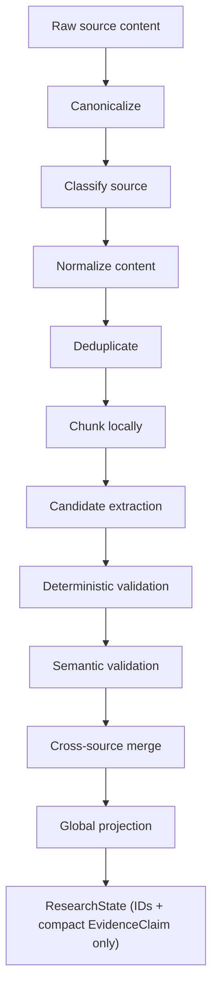

# Evidence System

The evidence-first pipeline that turns untrusted web content into verified,
atomic, citable claims. See [citation-verification.md](./citation-verification.md)
for the verification checks referenced here, and
[state-management.md](./state-management.md#evidenceclaim) for the full
`EvidenceClaim` schema.

## Principle

**Raw pages and provider JSON must never be appended directly to the
global prompt or central graph state. They are artifacts, not reasoning
context.**

This matters because:
- Raw pages can contain prompt-injection attempts (see
  [prompt-injection.md](./prompt-injection.md)).
- Full page bodies bloat `ResearchState` far beyond what a reducer or a
  downstream LLM call can reasonably handle, degrading both cost and
  quality.
- Without atomic, source-attributed claims, there is no way to verify a
  citation later or explain *why* the writer believed something.

## Distillation pipeline

1. **Canonicalize** — normalize URL, strip tracking parameters, capture
   retrieval time and content hash.
2. **Classify source** — official documentation, primary source, paper,
   news, secondary analysis, forum, or unknown (`Source.sourceClass`).
3. **Normalize content** — convert HTML/PDF to clean text while preserving
   headings and location offsets (needed for exact-span verification).
4. **Deduplicate** — compare canonical URL and content hash; merge mirrors
   and near-duplicates.
5. **Chunk locally** — split by semantic section within token bounds. Do
   **not** place all chunks in `ResearchState`.
6. **Candidate extraction** — the distiller worker emits atomic claims with
   an evidence span and source locator (unverified at this point).
7. **Deterministic validation** — confirm the cited span exists in the
   normalized source text and that the URL belongs to the stored source.
8. **Semantic validation** — the verifier assesses whether the span
   supports, contradicts, or is unrelated to the claim.
9. **Cross-source merge** — group semantically equivalent claims across
   sources and preserve disagreements (feeds the contradiction ledger).
10. **Global projection** — add only compact, verified `EvidenceClaim`
    records and IDs to graph state. The full page body stays in object
    storage.

## Source ingestion

Handled by `research_worker` + the canonicalization/classification steps
above. Every `Source` record captures: canonical URL, title, publisher,
provider, source class, published/retrieved timestamps, content hash,
`artifactRef` (pointer into object storage), and a quality score. Full
field list: [state-management.md](./state-management.md#source).

## Atomic claim extraction

Each `EvidenceClaim` should contain **one independently checkable
proposition**. It must not combine several facts under one citation. A
valid claim includes:

- The atomic claim text
- Source ID and canonical URL
- A short supporting passage or offset range
- Publication and retrieval timestamps, when known
- Support classification (`supported | contradicted | mixed | insufficient`)
- Source-quality score
- Confidence
- Contradictions and caveats
- Sub-question ID this claim addresses

## Claim ledger and contradiction ledger

- The **claim ledger** is the set of `EvidenceClaim` records reachable by
  ID from `ResearchState.evidenceClaimIds` — this is what the reflector
  and writer see (compact projections, not raw content).
- The **contradiction ledger** groups claims that disagree on the same
  proposition, surfaced to both the reflector (as a potential material
  gap) and the frontend's Gap and Conflict panel (see
  [ui-ux.md](./ui-ux.md)).

## Why raw content must not enter global graph state

- **Size/cost**: raw HTML/PDF bodies are orders of magnitude larger than
  a compact claim and would dominate every downstream LLM call's context.
- **Security**: raw content is untrusted and must be treated as data, not
  reasoning context — see [prompt-injection.md](./prompt-injection.md).
- **Auditability**: keeping raw content in object storage, referenced by
  `artifactRef` and content hash, lets any claim be re-verified against
  its exact source later, including after the run completes.
- **State-size limits**: `ResearchState.sourceIds` and
  `evidenceClaimIds` are capped (200 and 300 respectively) precisely
  because they hold IDs, not content — see
  [state-management.md](./state-management.md).
