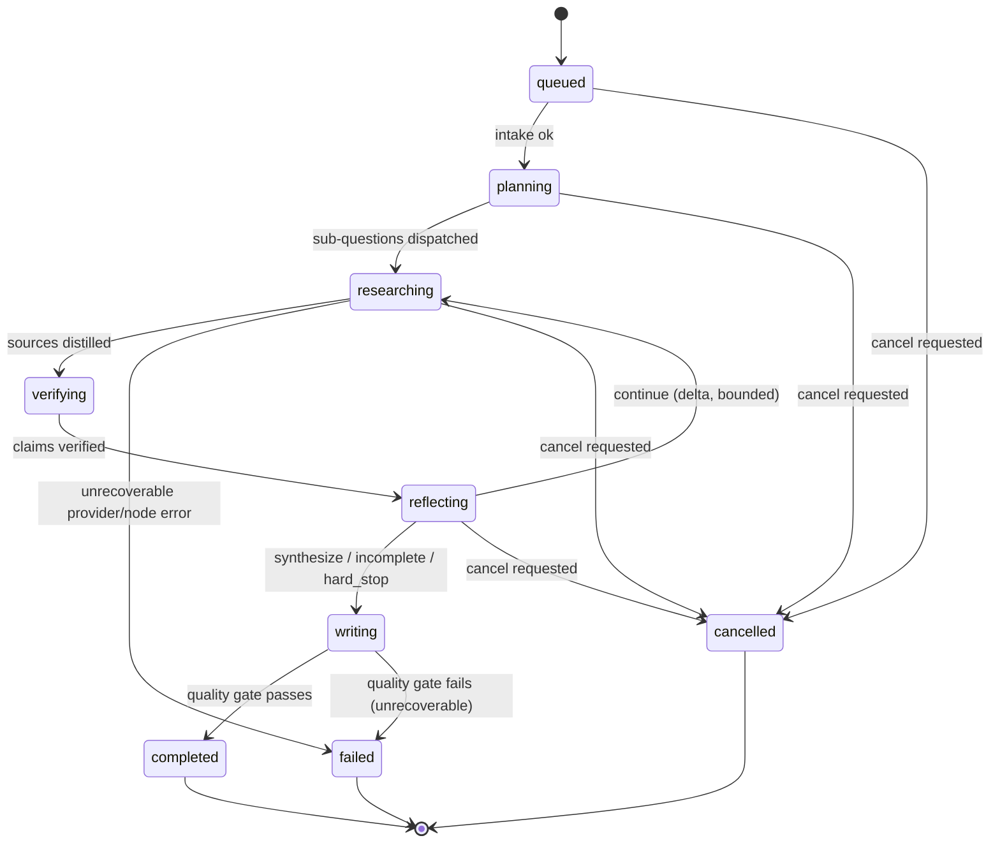

# LangGraph Implementation

See [architecture.md](./architecture.md) for why LangGraph is the sole
lifecycle orchestrator, and [state-management.md](./state-management.md)
for the `ResearchState` shape referenced here.

## StateGraph

The graph is built once over `ResearchState`:

```python
from langgraph.graph import StateGraph, START, END
from langgraph.types import Send

def dispatch_workers(state):
    pending = [q for q in state["sub_questions"] if q["status"] == "pending"]
    return [Send("research_worker", {
        "run_id": state["run_id"],
        "sub_question": q,
        "remaining_budget": remaining_budget(state),
    }) for q in pending[: state["concurrency_limit"]]]

def route_after_reflection(state):
    decision = state["reflection_decision"]
    hard_stop = (
        state["reflection_round"] >= state["budget"]["max_reflection_rounds"]
        or budget_exhausted(state)
    )
    if hard_stop or decision["decision"] in {"synthesize", "incomplete"}:
        return "writer"
    return "planner_delta"

graph = StateGraph(ResearchState)
graph.add_node("intake", intake)
graph.add_node("planner", planner)
graph.add_node("research_worker", research_worker)
graph.add_node("distill_and_verify", distill_and_verify)
graph.add_node("reflector", reflector)
graph.add_node("planner_delta", planner_delta)
graph.add_node("writer", writer)
graph.add_node("quality_gate", quality_gate)

graph.add_edge(START, "intake")
graph.add_edge("intake", "planner")
graph.add_conditional_edges("planner", dispatch_workers, ["research_worker"])
graph.add_edge("research_worker", "distill_and_verify")
graph.add_edge("distill_and_verify", "reflector")
graph.add_conditional_edges("reflector", route_after_reflection,
                            {"planner_delta": "planner_delta", "writer": "writer"})
graph.add_conditional_edges("planner_delta", dispatch_workers, ["research_worker"])
graph.add_edge("writer", "quality_gate")
graph.add_edge("quality_gate", END)
```

Graph implementation is `PLANNED` at
`services/research-api/src/research_api/graph/{builder.py,nodes/}`.

## Nodes

| Node | Purpose |
|---|---|
| `intake` | Validate request, set budgets, optional clarification |
| `planner` | Produce initial `SubQuestion` set |
| `research_worker` | Fetch sources for one sub-question |
| `distill_and_verify` | Turn source content into verified `EvidenceClaim`s |
| `reflector` | Decide continue/synthesize/incomplete |
| `planner_delta` | Produce a bounded delta plan targeting material gaps |
| `writer` | Draft the report from verified evidence |
| `quality_gate` | Final contract enforcement before completion |

Full per-node contract: [agents.md](./agents.md).

## Edges and conditional routing

- `dispatch_workers` is used for **both** the initial fan-out (from
  `planner`) and the delta fan-out (from `planner_delta`) — it reads
  whatever sub-questions are currently `pending`, so it is safely reused.
- `route_after_reflection` is the single place that decides whether to
  loop back for more research or proceed to synthesis. It is
  deterministic: the LLM/reflector's preference is overridden by
  `hard_stop` whenever a budget limit is reached.

## Send / fan-out-fan-in

- `Send("research_worker", {...})` creates one graph invocation per
  sub-question, run concurrently up to `concurrency_limit`.
- Fan-in at `distill_and_verify` must use **reducers that merge by stable
  ID** (`sourceId`, `claimId`) rather than positional list concatenation —
  parallel branches can return in any order or interleave.
- In the Python LangGraph runtime, prefer graph-native fan-out/reducers
  over hiding concurrency inside one opaque node function; this preserves
  per-branch retryability and tracing.

## Checkpoints and durable execution

- Use a LangGraph checkpointer backed by PostgreSQL (or an equivalent
  durable backend) for thread-scoped execution snapshots — see
  [database.md](./database.md).
- Long-term user preferences and reusable research memory belong in normal
  application tables or a LangGraph `store`, **not** in checkpoint state —
  keep these two concepts separate.
- A crashed worker is recovered by resuming from the last checkpoint, not
  by restarting the whole run — see [reliability.md](./reliability.md).

## Interrupts

Authenticated or side-effecting browser actions require human approval
before proceeding (see [prompt-injection.md](./prompt-injection.md)). This
is implemented as a LangGraph interrupt that pauses the graph until
`POST /api/research/runs/:runId/resume` is called with the approval.
`PLANNED` — exact interrupt call sites are implementation detail pending
repository inspection.

## Streaming

Node-level progress is emitted as events (`node.started`, `node.progress`,
etc.) to the append-only event log, which the Next.js BFF relays over SSE.
Do not rely on LLM token streaming alone as the observability mechanism —
the frontend renders durable events, not raw token deltas. See
[events-and-sse.md](./events-and-sse.md).

## Concurrency

- A **per-run semaphore** bounds concurrent workers within one run
  (`concurrency_limit`).
- A **global provider semaphore** bounds total concurrent calls to a given
  provider across all runs, protecting shared rate limits.
- `Promise.allSettled` (or the Python equivalent, bounded `asyncio.gather`
  with `return_exceptions=True`) is used wherever partial results are
  acceptable; `Promise.all`/unguarded `gather` is only acceptable when
  every task has independent failure capture upstream.

## Error handling

- Structured-output nodes (`planner`, `distiller`, `writer`,
  `reflector`) retry once with the validation error appended, then fail
  the run safely with a typed `errorCode`.
- Provider adapter errors are caught at the adapter boundary and returned
  as typed failures, never allowed to raise unhandled into the graph
  runtime.
- See [reliability.md](./reliability.md) for the full failure-mode matrix.

## Idempotency

- Node output writes use `(run_id, node_id, attempt, output_hash)`
  uniqueness.
- Provider calls carry request fingerprints.
- Cancellation and event publication are idempotent operations.

## Graph lifecycle



This mirrors `RunStatusSchema`:
`queued | planning | researching | verifying | reflecting | writing | completed | failed | cancelled`.
