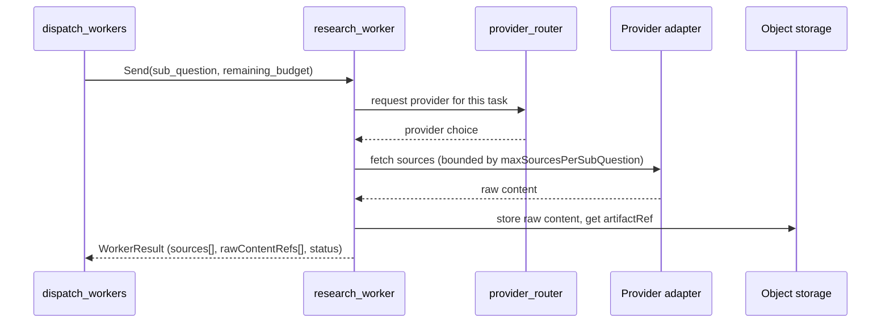

# Research Workers

Specialized `research_worker` role definitions. See
[agents.md](./agents.md#research-workers) for the base node contract.

## Roles

| Role | When created |
|---|---|
| official-source researcher | Sub-question's `sourceClasses` includes `official` (government, standards bodies, vendor docs) |
| recent-news researcher | Sub-question flagged fresh/time-sensitive by the planner or Jev's freshness judgment |
| technical-documentation researcher | Sub-question concerns a specific technology, API, or framework |
| academic evidence researcher | Sub-question's `sourceClasses` includes `paper`/`primary` and requires peer-reviewed grounding |
| contrarian / counter-evidence researcher | Reflector flags one-sided coverage as a material gap; created only in a delta round |

**Create roles dynamically, only when required by the plan.** Do not
instantiate all five roles for every run — most runs need a subset.

## Worker context isolation

Each worker invocation receives:
- Its own `SubQuestion` (question, rationale, successCriteria,
  sourceClasses, preferredProvider hint).
- `run_id` and a `remaining_budget` snapshot local to this invocation.
- A provider adapter selected by the router.

It does **not** receive:
- The full accumulated conversation or other workers' in-progress results.
- Direct write access to `ResearchState`.
- Any user secrets or session tokens beyond what its provider adapter call
  strictly requires.

## Local budgets

Each worker operates under `maxSourcesPerSubQuestion = 6` and a share of
the run's remaining `maxSearchCalls` / `maxBrowserSessions`. A worker that
exhausts its local budget returns whatever it has gathered rather than
requesting more — escalation decisions belong to the reflector, not the
worker.

## Tool access

A worker has access to exactly one provider adapter per invocation (the
one chosen by `provider_router`). It cannot call a different provider
mid-invocation. A CrewAI-backed worker may internally use multiple tools
as part of its role/task definition, but its external contract is still a
single `WorkerResult`.

## Result contract

```text
WorkerResult {
  subQuestionId: uuid
  sources: Source[]           # metadata only; content goes to object storage
  rawContentRefs: string[]    # artifactRef pointers, not inline content
  status: "complete" | "partial" | "failed"
  notes: string               # optional, for reflector/audit context
}
```

This is merged into `ResearchState.sourceIds` by a reducer keyed on stable
`Source.id` — never appended positionally (see
[state-management.md](./state-management.md)).

## Worker failure

A worker failure (provider exhausted all escalation options, or a
malformed/empty result after retry) sets `SubQuestion.status = "failed"`
and increments `attempts`. It does **not** fail the whole run — the
reflector sees the failed sub-question as a coverage gap and decides
whether to retry it differently in a delta round or accept the gap.

## Concurrency

Workers run under the graph's per-run semaphore (`concurrency_limit`) via
LangGraph `Send` fan-out (see [langgraph.md](./langgraph.md)). They are
independently retryable — one worker's failure does not block or cancel
sibling workers in the same fan-out.

## Worker lifecycle


