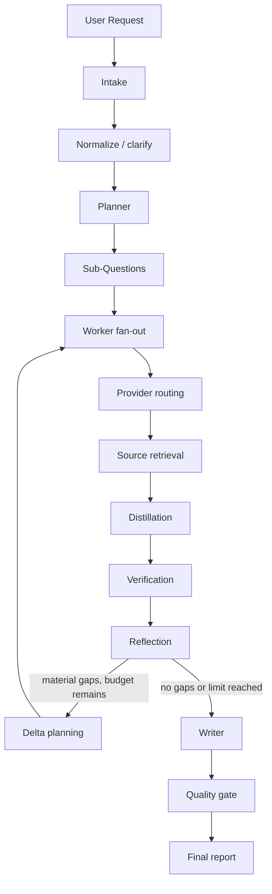

# Research Workflow

The end-to-end lifecycle of a single research run, from submission to final
report. See [architecture.md](./architecture.md) for the system-level view
and [agents.md](./agents.md) for per-node detail.

## Lifecycle diagram

```text
User Request
    |
    v
Intake
    |
    v
Normalize
    |
    v
Planner
    |
    v
Sub-Questions
    |
    v
Worker Fan-out
    |
    v
Provider Routing
    |
    v
Source Retrieval
    |
    v
Distillation
    |
    v
Verification
    |
    v
Reflection
    |
    v
Delta Research (conditional, bounded)
    |
    v
Writer
    |
    v
Quality Gate
    |
    v
Final Report
```



## Transition-by-transition explanation

### User Request → Intake
The client `POST`s to `/api/research/runs` (see [api.md](./api.md)). Intake
validates the request against the request schema, generates a `runId`,
sets `budget` from defaults/plan tier, and persists an initial run row with
`status: "queued"`.

### Intake → Normalize
Intake may ask **at most one** clarification question if the request is
ambiguous. Normalization produces `normalizedQuestion` and
`reportRequirements` from `originalQuestion`. This is deterministic +
LLM-assisted, not agentic.

### Normalize → Planner
The planner decomposes the normalized question into 3–8 non-overlapping
`SubQuestion` records, each with `successCriteria` and preferred
`sourceClasses`. Output is schema-validated
(`SubQuestionSchema`); on validation failure the planner retries once with
the validation error appended, then fails the run safely.

### Planner → Sub-Questions → Worker Fan-out
The `dispatch_workers` conditional edge emits one LangGraph `Send` per
pending sub-question, bounded by `concurrency_limit`. See
[langgraph.md](./langgraph.md) for the implementation.

### Worker Fan-out → Provider Routing
Each `research_worker` asks the `provider_router` to pick a provider for
its sub-question (Serper, Tavily, Parallel, or browser fallback). See
[provider-routing.md](./provider-routing.md).

### Provider Routing → Source Retrieval
The chosen provider adapter fetches candidate sources. Raw responses are
stored in object storage, never appended to `ResearchState`. See
[artifact-storage.md](./artifact-storage.md).

### Source Retrieval → Distillation
The `distiller` converts normalized source content into atomic claims with
evidence spans, caveats, and source metadata. See
[evidence-system.md](./evidence-system.md).

### Distillation → Verification
The `verifier` performs exact-span checks, source-identity checks,
semantic support classification, freshness checks, and contradiction
detection. See [citation-verification.md](./citation-verification.md).
Only verified claims are eligible to reach the writer.

### Verification → Reflection
The `reflector` compares the verified claim ledger and contradiction
ledger against the plan and returns a `ReflectionDecision`
(`continue` | `synthesize` | `incomplete`), a `coverageScore`, and up to 4
`materialGaps`. See [reflection.md](./reflection.md).

### Reflection → Delta Research (conditional)
If `decision == "continue"` **and** budgets allow **and** expected
marginal gain exceeds the configured threshold, `planner_delta` emits up to
4 new sub-questions targeting the material gaps, and execution returns to
worker fan-out. This loop is capped at `maxReflectionRounds` (default 2).

### Reflection → Writer
If `decision` is `synthesize` or `incomplete`, or a hard budget limit has
been reached, execution proceeds to the `writer`, which receives only the
verified evidence ledger and a report outline — never raw pages.

### Writer → Quality Gate
The `quality_gate` checks that every citation resolves to a stored source,
every cited claim is verified, no search-result snippet is presented as a
primary source, conflicting evidence is acknowledged, required sections
exist, no unsupported confidence is claimed, and markdown is safe to
render.

### Quality Gate → Final Report
On success, the run is marked `completed`, the report is persisted with a
versioned compare-and-swap, and a `run.completed` event carries the report
URL. On failure, the quality gate either triggers a bounded writer retry or
marks the run `failed` with a typed `errorCode`.

## Normal flow

The path described above with `decision == "synthesize"` on the first
reflection pass — the common case for well-scoped questions with good
source coverage.

## Failure flow

Any node can fail with a typed error. Failures propagate to
`status: "failed"` with an `errorCode` and a human-readable `message`, and
emit a `run.failed` event with a `retryable` flag (see
[events-and-sse.md](./events-and-sse.md)). Partial evidence gathered before
the failure remains queryable for audit even though the run did not
complete. See [reliability.md](./reliability.md) for the full failure-mode
matrix.

## Retry flow

- **Structured-output failures** (planner, distiller, writer): retry once
  with the validation error appended to the prompt, then fail safely.
- **Provider failures**: bounded retry with backoff, then circuit-break and
  fall back per the routing table in
  [provider-routing.md](./provider-routing.md).
- **Node crash**: LangGraph's checkpointer allows the graph to resume from
  the last durable checkpoint rather than restarting the whole run.

## Cancellation

`POST /api/research/runs/:runId/cancel` is idempotent. A cancellation
request sets a cancellation flag checked at node boundaries; in-flight
provider calls are allowed to complete or time out rather than being force
-killed mid-write, to avoid partial/corrupt evidence records. The run
transitions to `status: "cancelled"` once the current node boundary is
reached.

## Resume

`POST /api/research/runs/:runId/resume` resumes a run that was interrupted
(e.g., awaiting human approval for an authenticated browser action, or
recovered after infrastructure failure) from its last LangGraph checkpoint.

## Incomplete research

If the reflector returns `decision: "incomplete"` (material gaps remain but
budget/marginal-gain thresholds stop further research), the writer still
produces a report from what evidence exists, and the quality gate requires
that unresolved gaps be **acknowledged in the report**, not hidden. The run
status remains `completed`, but the report and event stream both surface
the incompleteness explicitly.

## Budget exhaustion

Hitting any hard limit (`maxSearchCalls`, `maxBrowserSessions`,
`maxWallClockMs`, `maxEstimatedCostUsd`, `maxReflectionRounds`) forces
`route_after_reflection` to route to `writer` regardless of the reflector's
preference — see [reflection.md](./reflection.md#hard-limits). This is a
deterministic, code-enforced stop, not a suggestion.
